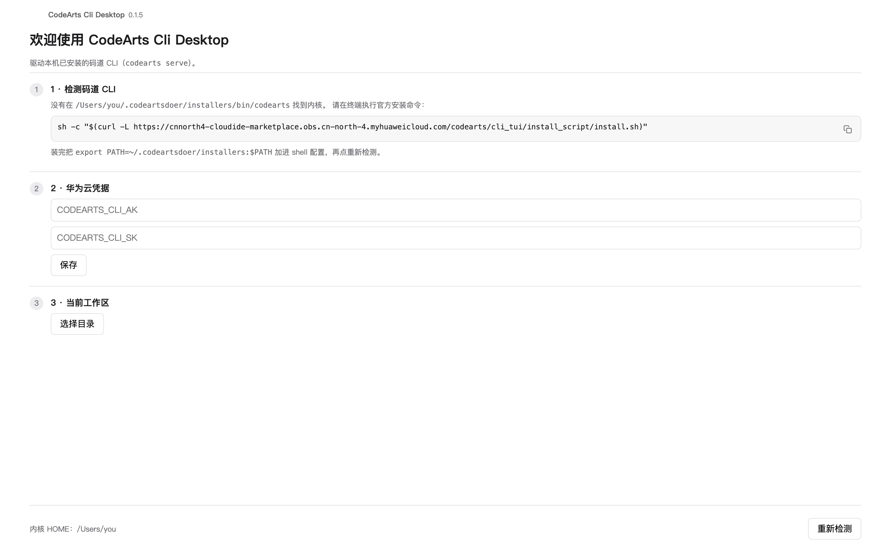
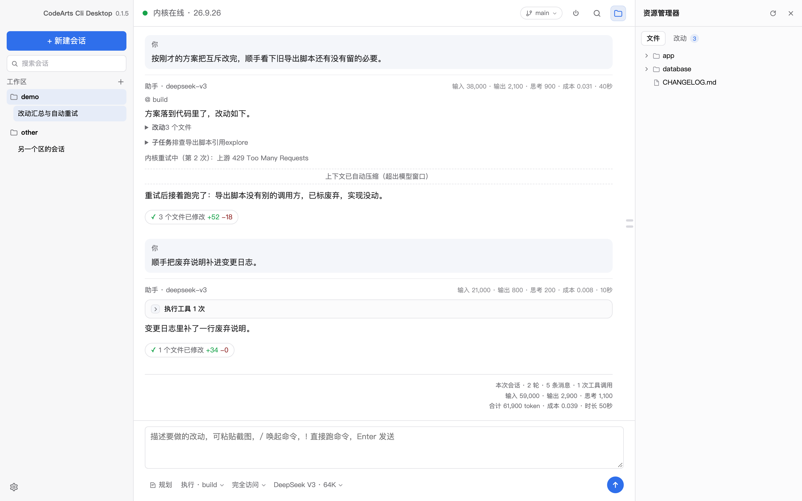

# CodeArts CLI Desktop

   

基于 Tauri 2 构建的非官方跨平台桌面客户端，驱动本机 CodeArts（码道）CLI。支持 macOS（Universal 二进制，兼容 Intel 与 Apple Silicon）与 Windows（x64 / arm64）。开源协议遵循 MIT。




## 核心特性

- **流畅会话交互**：支持流式输出、工具调用自动折叠、打断插单、消息排队流水线以及 409/限流智能递增退避重试。
- **多工作区与 Git**：支持无缝切换多项目工作区，后台会话独立记账并展示运行状态小圆点与角标；集成 Git 分支无缝切换。
- **代码与文件联动**：工作区文件树、代码高亮、逐行 Diff 对比，支持快捷键编辑保存（`⌘S` / `Ctrl+S`）与快速查找（`⌘P` / `Ctrl+P`）。
- **任务与权限体系**：子任务实时进度跟踪、动态待办悬浮胶囊、细粒度授权审批卡片与斜杠命令快捷补全。
- **配置与稳定性**：设置明文导入导出、网络断线权威快照自动对齐、危险命令告警拦截。

## 构建与运行

### 依赖环境
- Node.js 20+
- Rust stable (`rustup`)
- 本机预装官方 CodeArts CLI

### macOS

```bash
# 1. 安装依赖
npm install

# 2. 本地开发
npm run tauri dev

# 3. 打包（默认产出 Intel & Apple Silicon 通用的 Universal DMG）
npm run tauri build
```

*如需针对单一架构打包：`npm run tauri build -- --target aarch64-apple-darwin`（Apple Silicon）或 `x86_64-apple-darwin`（Intel）。*

### Windows (PowerShell)

```powershell
npm install
npm run tauri dev
npm run tauri build
```

*产出 NSIS 安装包（`*-setup.exe`）与 MSI 安装包，位于 `src-tauri/target/release/bundle/`。*

## 持续集成 (CI)

仓库支持 GitHub Actions 矩阵构建，无需本机环境即可直接在 [Actions → 构建安装包](https://github.com/17472439chaochao-lab/codearts/actions/workflows/installers.yml) 手动触发，直接下载 macOS Universal DMG 与 Windows 安装包。

## 测试

```bash
npm test        # 核心状态机与解析单测
npm run test:ui # 界面视觉回归测试（需要 Node 22+ 与 Chrome）
```

## 说明

本项目为社区开源客户端，所有交互与数据均保留在本地及用户自备内核，不上传至任何第三方云服务。CodeArts 相关知识产权归华为云所有。
