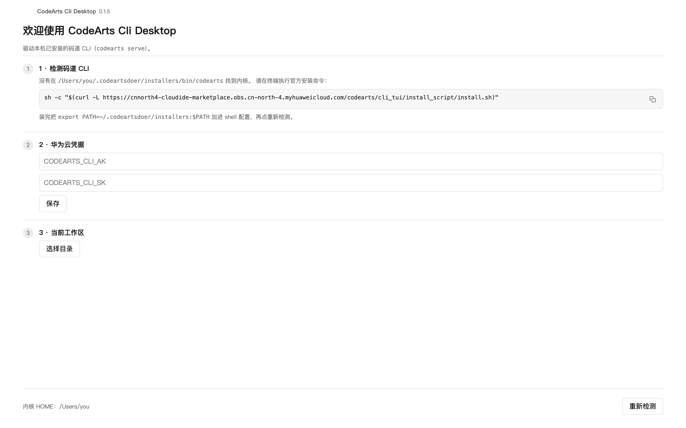
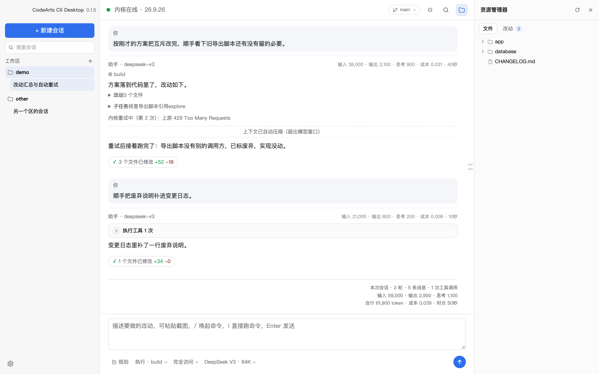

# CodeArts CLI Desktop

   

非官方的 **macOS 桌面端，用 Tauri 2 驱动本机码道 CLI**。官方只发布 Apple Silicon 包，Intel Mac 用这个。源码在 [GitHub](https://github.com/17472439chaochao-lab/codearts)，MIT 开源。




## 功能

- 会话：流式输出、停止与重试；工具调用按轮折叠，轮末汇总改动的文件
- 文件：按工作区浏览、预览、语法高亮与逐行 diff，文本文件可直接编辑并保存（⌘S）
- 多工作区切换不重启内核，后台会话继续跑；支持 Git 分支切换
- 子任务进展、待办清单、权限审批、反问选项与斜杠命令
- 设置整体导出/导入（明文 JSON，含凭据，文件权限 0600）；支持从 GitHub 安装技能
- 断线自动重连、限流自动重试、危险命令告警

## 构建

需要 macOS、Rust stable、Xcode Command Line Tools、Node 20+。

先安装官方码道 CLI：

```bash
sh -c "$(curl -L https://cnnorth4-cloudide-marketplace.obs.cn-north-4.myhuaweicloud.com/codearts/cli_tui/install_script/install.sh)"
export PATH=~/.codeartsdoer/installers:$PATH
```

```bash
npm install
npm run tauri dev
npm run tauri build -- --target x86_64-apple-darwin
```

只想看界面：`npm run dev`，打开 `/preview-setup.html`。

## 测试

```bash
npm test           # 消息合并与工具输出单测
npm run test:ui    # 浏览器回归，需要 Node 22+ 和 Chrome
```

## 说明

只出 macOS 包，不做自动更新；MCP 只做只读展示。本项目与华为云官方无关，CodeArts 名称及相关内核权利归华为云所有。