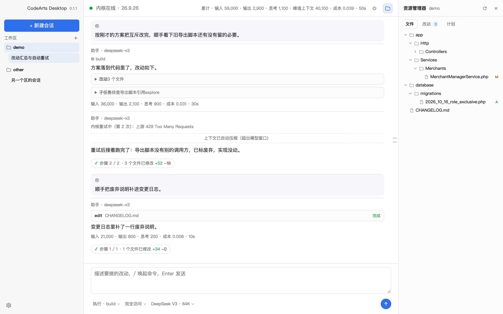
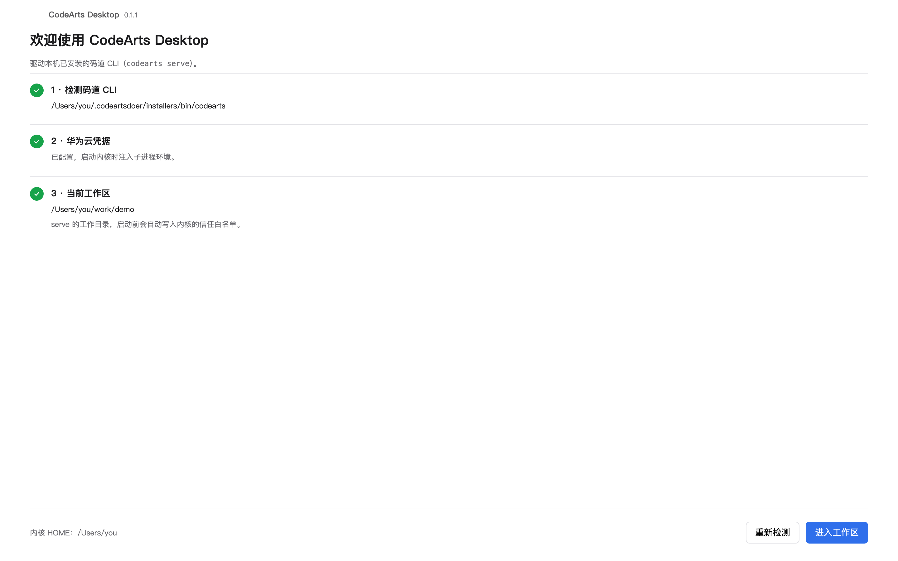

# CodeArts Desktop

本程序为Rust编写的华为云码道CodeArts的Mac桌面端（非官方版），官方只构建了 Apple Silicon 包，Intel版的Mac无法安装。



## 功能

- 会话聊天：新建、切换、删除，流式增量渲染，工具调用折叠卡片，中途可停止
- 文件侧栏：按工作区懒加载文件树，软件内预览、语法高亮和逐行 diff；agent 改过的文件标 A/M/D
- 计划：agent 进入/退出规划模式时自动切换，计划文件可在侧栏预览
- 多工作区：添加、切换目录，自动重启内核并写入信任白名单
- 子任务与待办：子任务进展实时展示，待办清单按轮快照，每轮末尾生成小结
- 权限与交互：权限审批、反问选项、斜杠命令、agent 与模型选择
- 稳定性：事件流断线自动重连、限流自动重试、危险命令告警、内核崩溃自愈
- 凭据：AK/SK 存本机，SK 不进前端、不回显

## 启动

首次启动进入检测页，码道 CLI、华为云 AK/SK、工作区三项都绿了才能进入：



## 构建

依赖 macOS、Rust stable、Xcode Command Line Tools、Node 20+。

先安装官方码道 CLI：

```bash
sh -c "$(curl -L https://cnnorth4-cloudide-marketplace.obs.cn-north-4.myhuaweicloud.com/codearts/cli_tui/install_script/install.sh)"
export PATH=~/.codeartsdoer/installers:$PATH
```

构建：

```bash
npm install
npm run tauri dev
npm run tauri build -- --target x86_64-apple-darwin
```

只想看界面、不装内核：先 `npm run dev`，再打开 `/preview-setup.html`。

## 已知限制

- 只出 macOS 包，Windows / Linux 不做
- 不做自动更新，内核升级是手动按钮
- 技能、MCP 只做只读展示，增删改仍要去 CLI 侧配置
