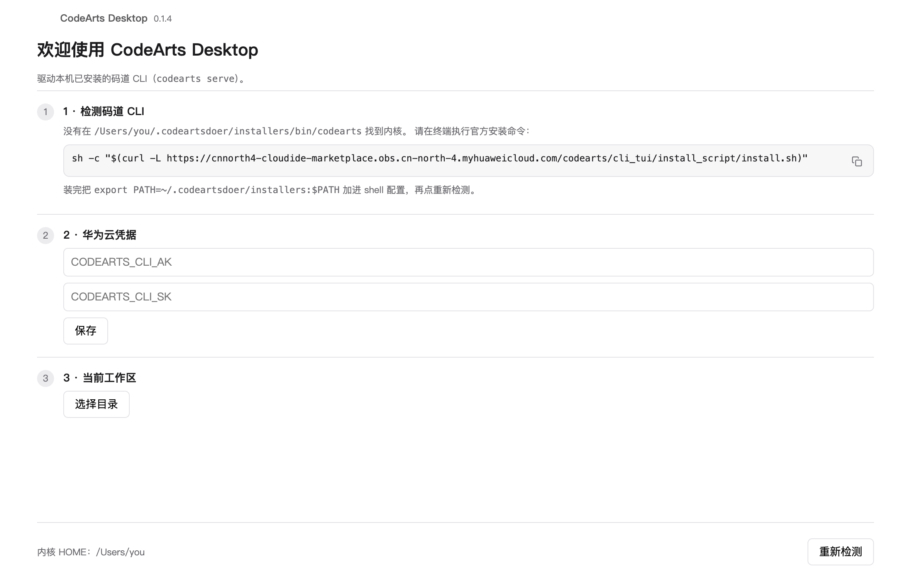
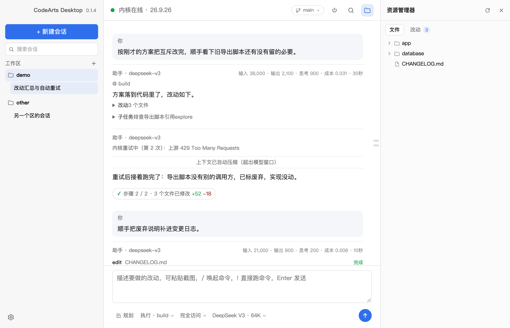

# CodeArts Desktop

   

**华为云码道 CodeArts 的 Mac 桌面端，开源（MIT）。** 源码开放在 [GitHub](https://github.com/17472439chaochao-lab/codearts)，可自由使用、修改、分发。

本程序用 Rust + Tauri 2 编写（非官方版），官方只构建了 Apple Silicon 包，Intel 版的 Mac 无法安装。

首次启动先过检测页，码道 CLI、华为云 AK/SK、工作区三项都绿了才给「进入工作区」：



主界面：左侧多工作区会话列表，中间流式会话（工具调用折成卡片、每轮末尾带步骤与文件改动小结），右侧资源管理器看文件与本次会话的改动：



## 功能

- 会话聊天：新建、切换、删除，流式增量渲染，工具调用折叠卡片，中途可停止
- 文件侧栏：按工作区懒加载文件树，软件内预览、语法高亮和逐行 diff；agent 改过的文件标 A/M/D
- 计划：agent 进入/退出规划模式时自动切换，计划文件可在侧栏预览
- 多工作区：添加、切换目录，切区不重启内核，后台会话继续跑；资源管理器标题栏的目录名可直接下拉切换
- Git 分支：顶栏分支胶囊点开可切本地/远程分支、从当前 HEAD 新建分支；会话运行中不给切，工作区有未提交改动时按 git 的判断拒绝并给出原因
- 子任务与待办：子任务进展实时展示，待办清单按轮快照，每轮末尾生成小结
- 权限与交互：权限审批、反问选项、斜杠命令、agent 与模型选择
- 技能安装：填 GitHub 仓库（`owner/repo`）即可装进用户级（全局）技能目录，支持更新与卸载
- 稳定性：事件流断线自动重连、限流自动重试、危险命令告警、内核崩溃自愈
- 凭据：AK/SK 存本机，SK 不进前端、不回显

## 启动

首次启动进入检测页，码道 CLI、华为云 AK/SK、工作区三项都绿了才能进入。

## 构建

依赖 macOS、Rust stable、Xcode Command Line Tools、Node 20+。

先安装官方码道 CLI：

```bash
sh -c "$(curl -L https://cnnorth4-cloudide-marketplace.obs.cn-north-4.myhuaweicloud.com/codearts/cli_tui/install_script/install.sh)"
export PATH=~/.codeartsdoer/installers:$PATH
```

构建：

```bash
npm install
npm run tauri dev
npm run tauri build -- --target x86_64-apple-darwin
```

只想看界面、不装内核：先 `npm run dev`，再打开 `/preview-setup.html`。

## 已知限制

- 只出 macOS 包，Windows / Linux 不做
- 不做自动更新，内核升级是手动按钮
- 技能只能从 GitHub 公开仓库装，私有仓库不走；装完要重载内核实例才生效。MCP 仍只做只读展示，增删改去 CLI 侧配置

## 开源许可

本项目以 [MIT 许可证](LICENSE) 开源，源码托管在 [GitHub](https://github.com/17472439chaochao-lab/codearts)。可以自由使用、修改、分发，包括商业用途；二次分发时保留版权声明和许可证全文即可。Issue 与 PR 都欢迎。

本程序是非官方客户端，与华为云官方无关；CodeArts 名称及相关内核的权利归华为云所有。
